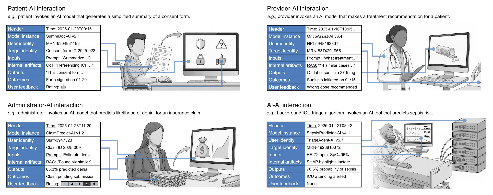

# MedLog: A Global Log for Medical AI

[](https://medlogprotocol.ai)
[](https://arxiv.org/abs/2510.04033)
[](https://github.com/mims-harvard/medlog)

Modern computer systems rely on syslog, a universal protocol that records critical events across heterogeneous infrastructure. Healthcare's rapidly growing AI stack has no equivalent. As hospitals deploy large language models and other AI tools, they still lack a standard way to record how, when, by whom, and for whom these models are used. Without such records, it is difficult to measure real-world performance and outcomes, detect adverse events, or identify bias and dataset drift. Here we introduce MedLog, a protocol for event-level logging of medical AI. Each time an AI model interacts with a human, another algorithm, or an automated workflow, MedLog creates a record. Each record contains nine core fields: header, model, user, target, inputs, artifacts, outputs, outcomes, and feedback.



We apply MedLog across four deployments in the US, Switzerland, and Vietnam: ICU deterioration prediction, tetanus progression monitoring from wearable signals, automated sepsis quality reporting, and patient attendance prediction. Event-level records capture model behavior, workflow interactions, and downstream outcomes, including AI performance degradation during severe weather events in patient attendance prediction and increased laboratory testing after ICU deterioration alerts.

This repository reproduces the figures and summary statistics for the four real-world deployments reported in the MedLog paper:

| Pilot | Location | Task | Paper |
| --- | --- | --- | --- |
| **BEACON** | Bern, Switzerland | ICU organ failure early warning | Figure 2 |
| **Vietnam** | Ho Chi Minh City, Vietnam | Tetanus progression from wearable PPG waveforms | Figure 3 |
| **UCSDH** | San Diego, California | LLM-based SEP-1 sepsis quality abstraction | Figure 4 |
| **MSSM** | New York, New York | Patient attendance prediction | Figure 5 |

Each pilot is a CLI subcommand: `uv run cli <pilot> <command>`.

## Quick start

### Prerequisites

- [uv](https://docs.astral.sh/uv/getting-started/installation/)
- [GNU Make](https://www.gnu.org/software/make/) (optional; for `make` targets)

### Install

```bash
make install      # or: uv sync
```

### Explore the CLI

```bash
uv run cli --help
uv run cli vietnam --help
```

## Input data

This repository contains code only. The pilot datasets are not included: they contain protected health
information (PHI) and/or are governed by data use agreements. Configuration for each pilot lives in
[`conf/default.config.yaml`](conf/default.config.yaml); by default the scripts read inputs from and write figures to
`data/<pilot>/`. To reproduce a figure, place the corresponding pilot data under `data/<pilot>/`
and run its command. Each command writes `PDF`, `SVG`, and `PNG` outputs to `data/<pilot>/figures/`.

| Pilot | Expected local input | Notes |
| --- | --- | --- |
| BEACON | `data/beacon/assembled.parquet` | Per-timestep model scores, alarms, labs, demographics, failure labels. |
| Vietnam | `data/vietnam/` raw alert export + PPG waveforms | `prepare` constructs the cleaned CSVs used by the figures. |
| UCSDH | `data/ucsdh/medlog_data.csv` | Agreement export (`batch,run,csn,question,answer`). |
| MSSM | `data/mssm/cache/*.pkl` | Pre-aggregated statistics, the encounter table is PHI. |

## Figure generation

### Figure 2: Bern, Switzerland

```bash
uv run cli beacon early-alarms      # panels b-d: alarm rates by failure group and admission time
uv run cli beacon feature-recency   # panels e-f: model prediction vs. arterial-lactate recency
uv run cli beacon human-response    # panels g-h: lab-order density and time-to-lab after alarms (Cox / log-rank)
uv run cli beacon fairness          # panels i-k: sex/age AUROC disparity + CUSUM change-point
uv run cli beacon stats             # Table 1 (Bern row)
```

The BEACON figure-generation code is adapted from the
[ETH Zurich Ratschlab ai4icu project](https://github.com/ratschlab); only
figure-generation logic is included here. All
commands read `data/beacon/assembled.parquet` (not included). For demonstration, `beacon fairness` falls back to
**synthetic** data (`src/fairness/testdata.py`) when the `.parquet` file is absent.

### Figure 3: Ho Chi Minh City, Vietnam

```bash
uv run cli vietnam prepare          # clean raw alerts/notes -> data/vietnam/cleaned/*.csv + per-alert MedLog JSON
uv run cli vietnam figures          # panels b-h: trajectories, model-probability ECDFs, reason/response bars
uv run cli vietnam waveforms        # panel a: four-panel raw PPG waveforms by alert cohort
uv run cli vietnam beat-overlay     # panel i: median-beat overlay (dismissed alert vs. baseline)
uv run cli vietnam stats            # Table 1 (Vietnam row)
```

Run `prepare` first: `figures` and `stats` read the cleaned CSVs it produces. `waveforms` and `beat-overlay` operate on
a single representative subject (`conf.vietnam.waveform_subject`, override with `--subject`); the baseline PPG windows in
`src/vietnam_analysis.py` are manually defined for the default subject.

### Figure 4: San Diego, California

```bash
uv run cli ucsdh heatmap            # panel c: pairwise-agreement heatmap (+ agreement/patient-id/summary CSVs)
```

### Figure 5: New York, New York

```bash
uv run cli mssm figures             # panels a-f: ROC, calibration by time/appt-change/outreach, weather deltas
uv run cli mssm stats               # reported calibration gaps + severe-weather deltas
```

MSSM figures are rendered from pre-aggregated statistics in `data/mssm/cache/`.

## Table 1

`<pilot> stats` reports statistics for the Vietnam and Switzerland pilots.

## Repository layout

```
conf/default.config.yaml     Per-pilot paths and settings
src/
  cli/                       Typer CLI (one sub-app per pilot)
  config/                    Pydantic settings loaded from conf/
  fairness/                  Fairness analysis library (from the ai4icu project)
  beacon_analysis.py         BEACON figure generation (Figure 2)
  vietnam_analysis.py        Vietnam figure generation (Figure 3)
  ucsdh_analysis.py          UCSDH figure generation (Figure 4)
  mssm_analysis.py           MSSM figure generation (Figure 5)
data/<pilot>/                Pilot inputs and generated figures (git-ignored)
```

To run code quality tools:

```bash
make check                   # lockfile consistency + ruff lint/format
```

## Development team

MedLog is developed by a global team across 51 institutions and 11 countries. Learn more at **[medlogprotocol.ai](https://medlogprotocol.ai/)**. Authors who contributed to code in this repository include:

- [Ayush Noori](https://www.ayushnoori.com/) (lead author)
- Aaron E. Boussina
- Hai Ho Bich
- James Anibal
- Julia Maslinski
- Manuel Burger
- Martin Faltys
- [Isaac S. Kohane](https://zaklab.org/) (co-corresponding author)
- [Marinka Zitnik](https://zitniklab.hms.harvard.edu/bio) (co-corresponding author)

For the full team, please see [medlogprotocol.ai/team](https://medlogprotocol.ai/team).

## Get involved

Interested in sharing feedback about the MedLog protocol design, joining the MedLog team, or piloting MedLog to
monitor a deployed health AI model at your institution? Please visit
[medlogprotocol.ai/get-involved](https://medlogprotocol.ai/get-involved) or contact
[Ayush Noori](mailto:ayush.noori@sjc.ox.ac.uk), [Zak Kohane](mailto:isaac_kohane@hms.harvard.edu), and
[Marinka Zitnik](mailto:marinka@hms.harvard.edu).

## License

This project is released under the [MIT License](LICENSE). The BEACON figure code is adapted from the
[ratschlab/ai4icu](https://github.com/ratschlab).
